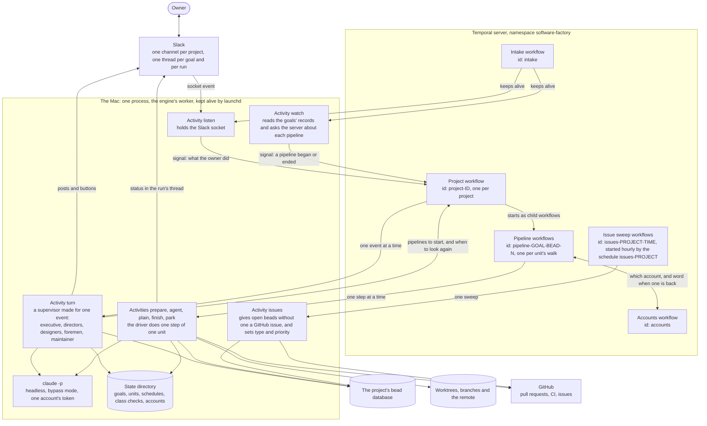
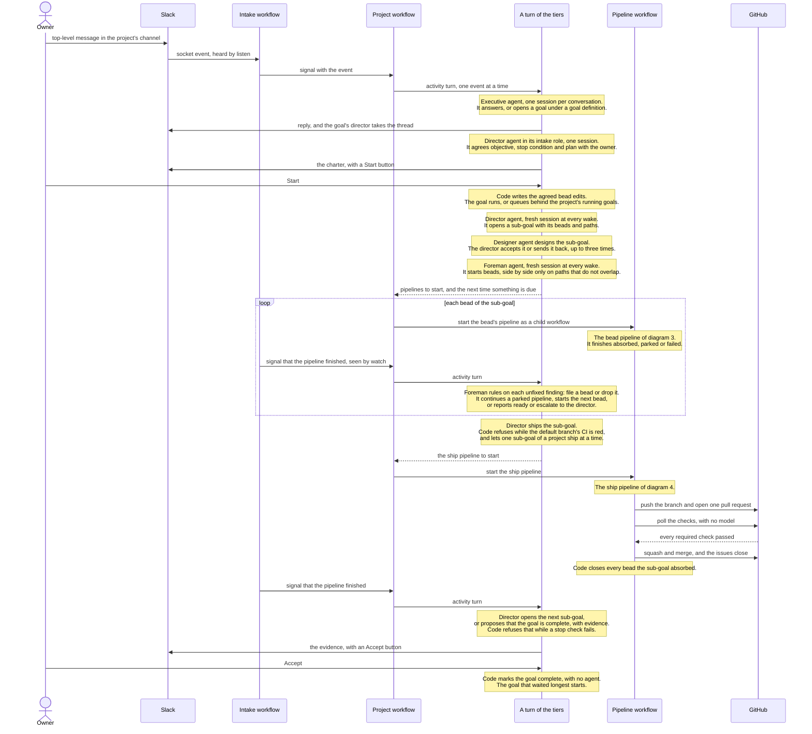
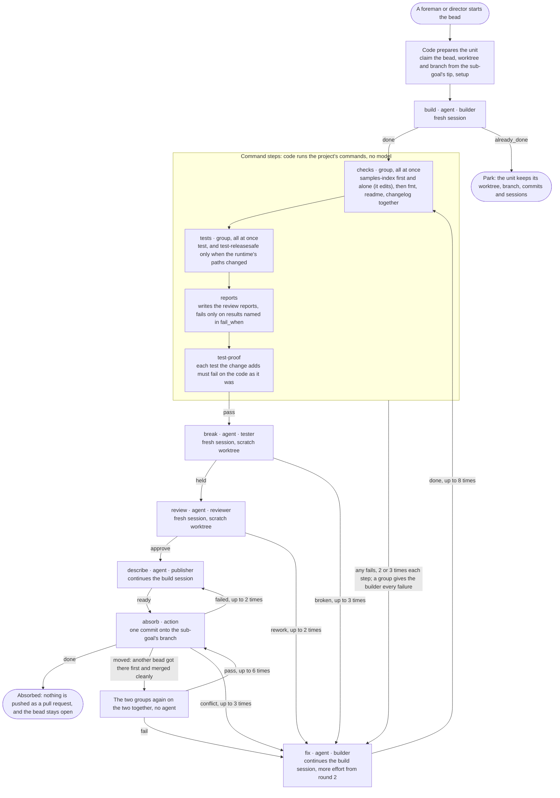
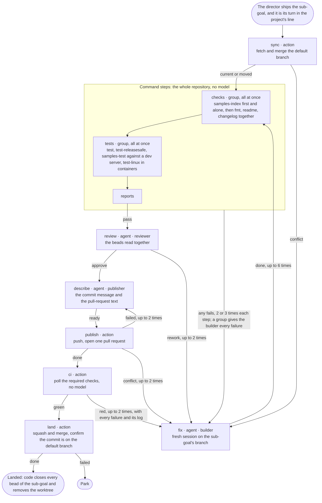
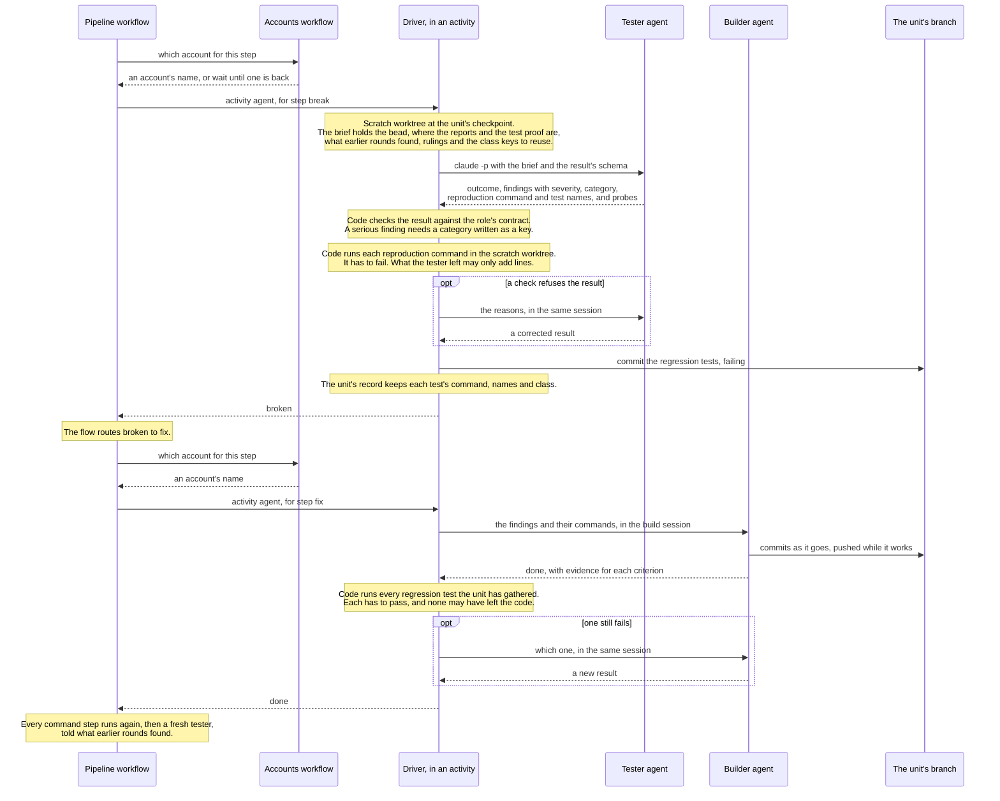
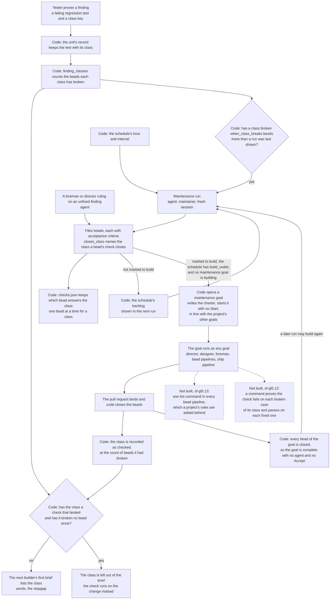
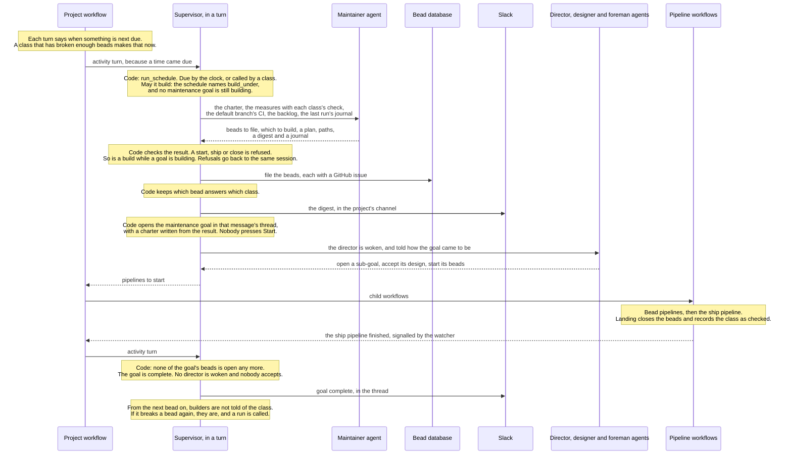

# How the factory works, in diagrams

This page draws what [architecture.md](architecture.md) says in prose. It shows the factory as the code and the config are on 2026-11-16, with the Zig SDK as the project. Terms are used as the [glossary](glossary.md) defines them.

Two rules explain most of the shapes below.

- **Agents propose and code acts.** Every box marked *agent* returns a typed result. Code checks it, and code does everything that changes the world: commits, pushes, pull requests, merges, beads, Slack.
- **Nothing waits in a process.** Whatever waits, retries or remembers is a workflow on the Temporal server. The one process on the Mac, the engine's worker, does their work as activities.

## 1. The parts, and what talks to what

The dashboard (`factory-dash`) is outside this picture on purpose: it only reads the state directory.

## 2. A goal, from the owner's message to a landed pull request

Every message and button press of the owner takes the path of the first four arrows. After that the diagram draws it as one arrow.

## 3. One bead's pipeline

This is `config/flows/zig-sdk-bead.toml`. A flow is data. The pipeline workflow walks it one step at a time, and each step is an activity. A group of commands is one step: its commands run at the same time, and the step decides once every one has ended.

Not drawn, to keep it readable:

- A route that has been used as often as it allows parks the unit. Whoever runs the sub-goal's beads may continue a parked unit from a step it names, up to three times.
- Any agent step may return `needs_owner`. The question goes to the run's thread and the answer comes back to that step.
- After every step the driver pushes the unit's branch to the remote, and during a builder's run each time it commits.

## 4. Shipping a sub-goal

This is `config/flows/zig-sdk-ship.toml`. It runs once on the sub-goal's branch, which holds one commit for each bead.

## 5. One round of the tester, and the fix

This is where a finding and a fix are settled by a test that code runs, and not by what an agent says.

## 6. From a finding to a check that every later bead runs

Owner's decision, 2026-11-16: this loop closes with nobody in it, and what can be a tool is not left as prose. Boxes marked *code* involve no model. The dashed boxes are not built yet.

Until the lint command exists, a check the loop builds gates later beads only if it lands inside a command the bead flow already runs, such as `zig build test`.

## 7. A class of defect calls a maintenance run

The same loop in time, on the engine. `upkeep` is the Zig project's scheduled definition, and it builds under `parity`.

## Where each diagram comes from

| Diagram | Code and config |
|---|---|
| 1 | `crates/factory-engine/src/tiers.rs`, `engine.rs`, `accounts.rs`, `steps.rs`, `worker.rs` |
| 2 | `crates/factory-driver/src/goal.rs` (`Supervisor::turn`, `wake`, `wake_foreman`, `ship`, `act`), `config/goals/temporal-sdk-zig/parity.toml`, `config/roles/` |
| 3, 4 | `config/flows/zig-sdk-bead.toml`, `config/flows/zig-sdk-ship.toml`, `config/projects/temporal-sdk-zig.toml` |
| 5 | `crates/factory-driver/src/lib.rs` (`agent_step`, `verify_reproductions`, `adopt_regressions`, `check_regressions`), `crates/factory-brief/src/lib.rs` (`result_problems`) |
| 6, 7 | `crates/factory-driver/src/goal.rs` (`run_schedule`, `classes_calling`, `maintenance_problems`, `open_maintenance`, `settle_maintenance`), `crates/factory-driver/src/lib.rs` (`finding_classes`, `answer_class`, `check_landed`, `classes_unchecked`), `config/goals/temporal-sdk-zig/upkeep.toml` |

A diagram that no longer matches these is wrong: change it with the code.
